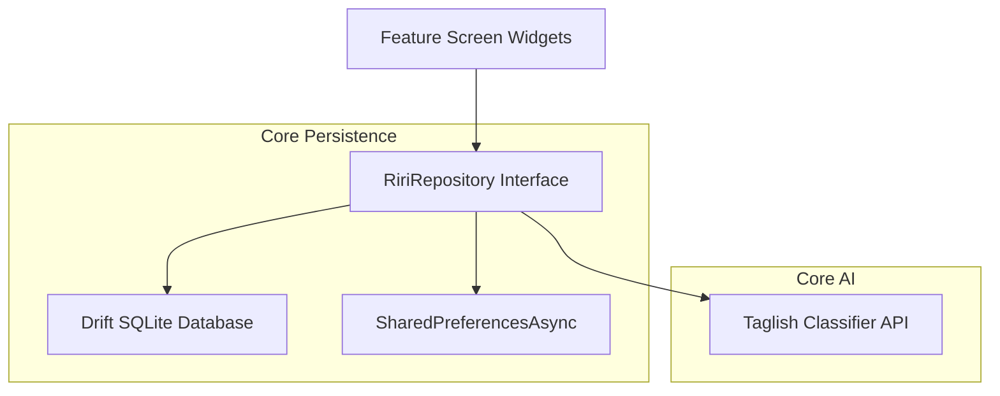

# Riri System Architecture

This document maps out the system architecture of **Riri (Gen Z Taglish Reminder & Chat App)**. The codebase is written in Flutter and follows a Clean Architecture design pattern partitioned into **Core** and **Feature** modules.

---

## Folder Structure

All primary source code resides in `riri_flutter/lib/`:

```
lib/
├── core/
│   ├── ai/               # Taglish heuristic classifier & LLM configs
│   ├── notifications/    # Personas configuration and templates
│   └── persistence/      # Drift SQLite DB schemas & RiriRepository
├── features/
│   ├── chat/             # Chat UI and message streams
│   ├── dashboard/        # Dashboard layout & dynamic sticker views
│   ├── onboarding/       # Setup flow & username instantiation
│   ├── reminders/        # Add reminder modal sheet views
│   └── settings/         # Persona switcher & options panel
├── theme/
│   └── riri_theme.dart   # Unified Material 3 Dark theme config
└── main.dart             # Application shell injection & singleton boots
```

---

## Clean Architecture Layers

To ensure long-term survivability and keep the system decoupled, code is layered as follows:



### 1. Core Persistence Layer
Exposes `RiriRepository` to the screens. No screen interacts with Drift database operations or SharedPreferences keys directly. 
- All data models map through explicit DTO translators (e.g., `Reminder` -> `RiriReminder`) at the repository boundary.

### 2. Core AI Layer
Exposes `TaglishKeywordClassifier` which extracts intent and structures scheduled tasks dynamically. It is entirely independent of storage details and can be executed synchronously.

### 3. Feature Layer
Divided into standalone, modular modules (`chat`, `dashboard`, `onboarding`, `reminders`, `settings`).
- Features only read data streams from `RiriRepository` and trigger actions.
- No direct persistence or file system reads exist in feature widgets.

---

## State Management Principles
- **Riverpod Providers** are used to manage shared controllers.
- Providers are initialized as singletons or auto-disposable configurations within `lib/core/` or partitioned features.
- Any change in the SQLite database automatically flows down into the feature UI via reactive Stream subscriptions.
